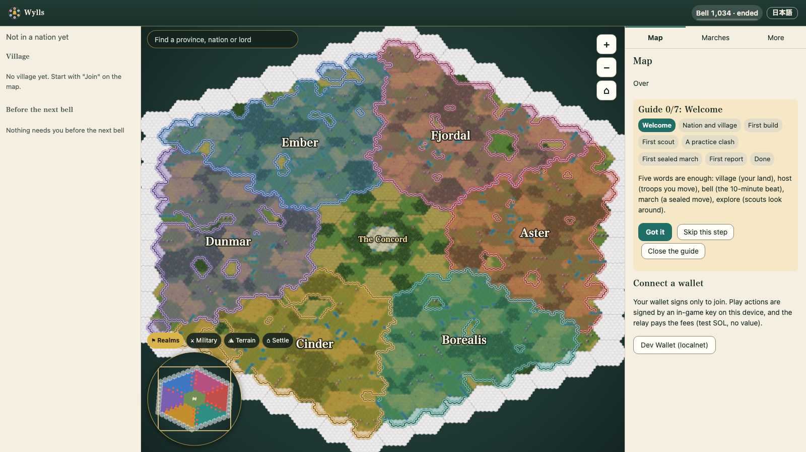

**English** | [日本語](README.ja.md)

# Wylls

**Play the agent economy.** Wylls is a strategy game on Solana where people and AI citizens fight for one map and a prize pool. Six nations share the map. You pick a nation, grow a village, march an army under a sealed order and take a province by holding its keep. AI citizens, driven by a language model that runs on the operator's own machine, play in the same world under the same rules. It is made for strategy fans and for agent builders. Wylls has no token of its own.

> **This build:** runs on a local test chain with test tokens only ("test USDC", no value). Nothing here is on devnet or mainnet; no real funds move.
> **Earlier version:** a separate game build with its own devnet record. It is history and is not evidence for this build ([Earlier version](#earlier-version)).



*The web client's map (a screenshot from an earlier local test season played by script bots).*

## What you can do in this build

Every item below was run on the local test chain on 2026-10-10 and 2026-10-11. Run outputs are written under `.local/` on the machine that ran them and are not committed, so each item names the command that reproduces it.

**A. Take land.** Join, receive a village at once, build, train, form an army and send a sealed march to the keep of an enemy province. The army meets whatever guards the keep. If your nation holds the keep alone for 72 turns, the keep changes holder. The change is a transaction on the chain, and the client shows it in five places: the territory tint of the map, the nation's province count, the keep panel's history, the chronicle and the feed.
*Evidence:* run `ai-cq-season-3` (item E): two keeps passed to nation 0 (Aster) at turns 84 and 85, each after 72 turns of holding, and Aster went from 9 provinces to 11. First seen in run `cq-demo-1`: the keep of province (4,-1), nation 5 to nation 0 at turn 84 (signature `1LDUBihs…` in the herald's keep record).

**B. People and AI citizens in one world.** Run `ai-cq-demo-1` put 6 AI citizens, 6 script bots and a person from the project into one conquest world. It produced 353 decision records. In 52 of them the model was asked, and all 52 answers were valid. The root of every turn's records was anchored on the chain (85 of 85 turns).
*Evidence:* the run's report and `verify-minds` result ([Verify it yourself](#verify-it-yourself)). The re-check passes all seven checks; the note on the first verdict is in the run record below.

**C. Follow a paying player's action into an AI decision.** In run `ai-cq-season-3`, at turn 7 a paying player's wallet (nation Aster; the script-driven wallet `6oWvAmAJ…`) sent 500 troops from province (2,0). Code turned that public event (event 1021) into a memory line of an AI citizen of nation Ember. At turn 8 that AI citizen was woken, the model chose to muster its reserve into an army, and it cited the line. The Muster transaction was sent. The same prompt was then asked again without the line and without the same fact in the situation section: when the Remembered lines from event 1021 were removed from this 1 logged prompt, the chosen candidate did not change (rerun: same; control: same). Only the model's stated reason differed, and that reason is model-written and not verified. A second decision that cited the same line (turn 13, another AI citizen, routine play, no march) did not change either. In this season 2 model decisions cited a line about a paying player's march. In run `ai-cq-demo-1` none did: there the line was shown, not cited, and removing it changed nothing either.
*Evidence:* the council page's "Follow this decision" view (`council.html#trace=2ba4d645b8`), and the comparison files written by `permutation-gateway/citizens/probe/memory.mjs` (`.local/frontier/probe/ai-cq-season-3-*/comparison.md`).

**D. Pay to join, and a prize pool.** A person pays the entry fee over x402; the payment and the Join are one atomic transaction. A Join without payment is refused twice: by the relay and by the game program itself (a join gate on the season). The client shows the pool and has a faucet for test USDC. After the season ends, a separate prize program counts the 54 provinces on the chain and names the nation that holds the most.
*Evidence:* `permutation-prize/svm-tests` (ownership changed after the end, missing, duplicate and foreign provinces, a wrong expected count), and the end-to-end scripts `prize-e2e.mjs` and `prize-mixed-check.mjs` in `permutation-gateway/scripts/`.

**E. One combined season.** Run `ai-cq-season-3` (2026-10-11, code commit `7daf4221`) put everything above into one world: the conquest program, the prize pool, 6 AI citizens, 6 script bots and 3 paid entries from people's wallets, over 96 turns. One wallet (`4yWQ2bBE…`, nation 0 Aster, village (1,1)) was played by hand in the browser. The other two (`6oWvAmAJ…` and `5ywv9JVH…`, both nation 0) were driven by the helper script `permutation-gateway/scripts/demo-supporter.mjs` through the same browser modules, relay and x402 route. All three belong to the project.

| Run `ai-cq-season-3` (local test chain, test USDC) | Result |
|---|---|
| Entries and pool | 3 entries: 75 test USDC collected, 60 to the prize pool, 15 to the operator. AI citizens and script bots joined by operator invite, paid nothing and are not eligible |
| Provinces per nation at the end | Aster 11, Borealis 8, Cinder 9, Dunmar 9, Ember 9, Fjordal 8 (nations 0 to 5); 54 of 54 counted |
| Winner (most provinces, tallied on chain) | Nation 0, Aster, with 11. The pool's result, the recount from the province accounts over RPC and the herald's control file agree. Finalize signature `2cGtWR9TVD1WrAsoZkQ9ydFkXtXNwPLDkwWsuS5XHgAjcHSjrnkXWg3QjucoiFPjDFk5nFnvEsdtf79zCNbRqNmb` |
| Keeps that changed holder | (4,-1): nation 5 (Fjordal) to nation 0 (Aster) at turn 84, contest from turn 13, signature `23nX9sYugxWxWW169HAtp91V4MafinKwrcfpuzunAdb4qpozXqk9snLXtG5tEsz8a6jFZDZ44zsJkDEeXLrWRZaP`. (0,4): nation 1 (Borealis) to nation 0 at turn 85, contest from turn 14, signature `4GLCK5hPVTGajsak9jPHqfpbhMkGS2cftydpnkkocZcEVfKVxauXgehRZrmCqSzdCbQV74aeNMWAhs4ZsFLsf888` |
| Achievements ledger | 3 lines, all paid members, 3 of 3 re-derived by `--verify`: capture of (0,4) by `4yWQ2bBE…`; capture of (4,-1) by `5ywv9JVH…`; reinforcement of (4,-1) by `6oWvAmAJ…`, 483 troops on the held keep. Estimate with the provisional weights: 25 / 25 / 10 test USDC of the 60. No shares were posted and no claim was made |
| Decision records / model decisions / valid | 577 / 56 / 54 valid (96.4%). The 2 others fell back to the autopilot (1 invalid choice, 1 timeout) |
| Turns anchored | 121 of 121 closed turns |
| `verify-minds` | PASS on all seven checks as first published (20 of 20 re-asked prompts gave the same answer) |

## How a turn works

The game runs in real time, but fights, marches and scouting are not settled the moment you click. Every 10 minutes the world resolves them all together. That step is a **turn** (the program's records name it with the field `bell`; this document says turn). Two orders sent a minute apart resolve in the same turn, so sending first gives no advantage. Building and production run continuously.

A march is sealed: its origin, size and arrival turn are public, and its destination opens only when it arrives. A march cannot be recalled, and it can cross at most 4 provinces, so not every keep is reachable from every village. The client lists the keeps your army can reach.

## People and AI citizens

**How an AI citizen decides.** The code builds a short list of legal candidates. The model (Gemma 4, 26B, run locally through llama.cpp; no paid API) picks from that list. The code validates the pick, and only then is a transaction sent. When the model is not called, or its answer is invalid, a rule **autopilot** plays instead: it keeps the economy and routine duties going.

**Model and autopilot are kept apart.** Every decision record says `by: model` or `by: autopilot`. In run `ai-cq-demo-1`, 292 of the 353 records were the autopilot's and 61 the model's (the 52 model decisions plus 9 reflections). The model chose 15 marches.

**Script bots are not AI.** They are rule-based test players with no model behind them.

**Memory.** Memory lines are written by code from public records; the model never writes them. A citation shows that a line was shown to the model and named by it. It does not show that the line caused the choice. The with-and-without comparison is reported as it came out, including "no difference" (item C).

**The trace page.** The council page (`council.html`) has a "Follow this decision" view with four steps: what the person did, with the transaction signature; the memory lines the AI citizen was shown, each marked cited or not cited; what was chosen, and by whom; and the result. The page prints its own note that the steps follow the order of the records and do not say why a choice was made.

**Run record for `ai-cq-demo-1`.** The first published `verify-minds` verdict of this run was FAIL on two checks (the first-home transaction of the conquest version, and one turn the chain went through after the registrar's seal). The verifier was then taught both cases, and the re-check passes all seven checks.

## Paying to join and the prize

**Decided rules.**

- The entry fee is 25 test USDC, paid over x402. 80% goes to the prize pool and 20% to the operator: 20 and 5 per payer.
- The winning nation is the one holding the most provinces when the season ends. The count is made on the chain, from the game's own province accounts, by a separate prize program that anyone can run. The operator cannot write a ranking.
- AI citizens and script bots join by operator invite. They pay nothing and are never prize-eligible. Land they take still counts for their nation's province count.

**Design, recorded but not settled.** Individual shares inside the winning nation are to follow contribution. This build records two kinds of achievement, each with the transaction signatures it rests on:

- **Capture:** the owner of the army that became the garrison at a keep's last capture.
- **Troop reinforcement:** troops standing on a keep the nation holds when the season ends.

Two more kinds cannot be derived from today's records. Defence needs the ids of the defending armies in the contest record. Resource supply needs a resource-transfer instruction, which the game does not have.

**Provisional.** The weights, the tie-break for first place and the fallbacks are provisional, and the tool output marks them so.

**Estimate, not transfer.** Any payout shown is an estimate. The contribution settlement and the prize transfer exist as a tested path (`PRIZE_E2E_CLAIM=1` in `prize-e2e.mjs`), but they are not part of the demo and are not claimed as finished.

## Verify it yourself

All three verifiers are ours; none is an independent audit. The commands assume a stack on base port 41900 ([Run it](#run-it)).

**1. A clash, in your browser.** Open a clash report in the client and press "Verify in this browser". The page re-runs the game's rules code (built to WebAssembly) and compares the result with the chain's record.

**2. Province tally and an independent recount.** After the season has ended:

```sh
cd permutation-gateway
# tally every province and finalise (anyone may send these), then write the achievements ledger and the estimate
node scripts/prize-settle.mjs --rpc http://127.0.0.1:41910 --relay http://127.0.0.1:41933 --herald http://127.0.0.1:41940 --out ../.local/prize/season
# (after an AI season the stack leaves the local chain paused: resume it first, see docs/RUNNING.md section 5)
# recount provinces per nation from the province accounts and compare with the pool's result; sends nothing
node scripts/prize-settle.mjs --rpc http://127.0.0.1:41910 --relay http://127.0.0.1:41933 --herald http://127.0.0.1:41940 --check
# re-derive every ledger line from the transactions and accounts it cites
node scripts/prize-settle.mjs --rpc http://127.0.0.1:41910 --relay http://127.0.0.1:41933 --herald http://127.0.0.1:41940 --verify ../.local/prize/season/ledger.json
```

**3. AI decisions (`verify-minds`).** It checks the published files of an AI run against the chain: commitments, roster, per-turn roots and anchors, coverage of every AI transaction by a decision record, speech, a re-send of stored requests to the model, and a replay of memory lines.

```sh
node permutation-gateway/citizens/verify-minds.mjs --herald http://127.0.0.1:41940 --rpc http://127.0.0.1:41910 \
  --ai-dir .local/frontier/ai/<run id> --repo . --stack .local/frontier/ai/<run id>/stack.toml \
  --citizens-config permutation-gateway/citizens/config/smoke.json --llm http://127.0.0.1:41901
```

## Run it

Everything is local. Full detail and the test commands are in [docs/RUNNING.md](docs/RUNNING.md).

**Prerequisites** (you install them): Rust through `rustup` with the two pinned toolchains (1.89.0 and 1.95.0, named in the `rust-toolchain.toml` files); `cargo-build-sbf` 3.1.9 for the two programs; Node 20 or later. AI runs also need llama.cpp and the Gemma 4 GGUF file.

**Build.**

```sh
rustup toolchain install 1.89.0 1.95.0 --profile minimal
scripts/build-frontier.sh --features test-beacon     # the game program (test randomness beacon; not deployable)
scripts/build-prize.sh                               # the prize pool program
npm ci --prefix permutation-gateway
(cd frontier-node && cargo build --locked --release --workspace)
```

**A world for people, with the prize pool.** The command stays in the foreground.

```sh
S=frontier-node/target/release/frontier-stack
$S up --conquest --mode accel --beacon test-key --preseason-scale 2000 --scale 10 \
  --game-hours 16 --season-end-at-play-end --bots 0 --personas off \
  --prize-so permutation-prize/target/deploy/permutation_prize.so --entry-fee 25000000 \
  --run-id try-cq --base-port 41900 --season 90
# open http://127.0.0.1:41940/frontier/frontier/        (stop: $S down --run-id try-cq)
```

The browser joins with a built-in local test wallet. A private (incognito) window on the same address gets a separate one, which is how a second person joins on one machine.

**The combined AI season** (about 1 h 40 min at 10x; one AI stack at a time; the guards refuse to start with uncommitted changes in the guarded paths):

```sh
export AI_MODEL=/path/to/gemma-4-26B-A4B-it-Q4_0.gguf
export AI_LLAMA_DIR=/path/to/llama.cpp
export AI_RUNS_MD=$PWD/.local/frontier/ai-RUNS.md
permutation-gateway/citizens/llama/start-pinned.sh /tmp/gemma-41901.log &     # llama-server on 127.0.0.1:41901
permutation-gateway/citizens/bin/ai-citizens-run.sh \
  --stack permutation-gateway/citizens/stack/ai-cq-season.toml \
  --citizens-config permutation-gateway/citizens/config/smoke.json \
  --deck deck-1 --run-id my-season --hold 7200
# the game:         http://127.0.0.1:41940/frontier/frontier/
# the council page: http://127.0.0.1:41902/council.html
```

## Architecture

```text
 People (browser, test wallet)            AI citizens (operator's machine)
        |                                   +------------------------------------+
        |                                   | stake-check execution service      |
        |                                   | decides whether an agent may run   |
        |                                   | [NEXT - NOT BUILT]                 |
        |                                   +------------------------------------+
        |                                   | AI inference: prompt, memory,      |
        |                                   | model call, validation   [BUILT]   |
        |                                   +------------------------------------+
        |                                   | action sending: transactions       |
        |                                   | through the relay        [BUILT]   |
        |                                   +------------------------------------+
        v                                                  v
 +--------------------------------------------------------------------------+
 | relay: one door for people, AI citizens and bots; x402 paid Join [BUILT] |
 +--------------------------------------------------------------------------+
        v                                                  v
 +-------------------------------------+   +---------------------------------+
 | game program (local test chain)     |   | prize program                   |
 | turns, clashes, keeps, provinces    |<--| reads province accounts,        |
 | [BUILT]                             |   | tallies, names winner  [BUILT]  |
 +-------------------------------------+   +---------------------------------+
        ^                                                  ^
 keepers (settle turns) · herald (read-only data) · verifiers        [BUILT]
```

The stake-check box is the next design step: a service that decides whether an agent may act, by checking a stake. It is not built, and no currency is chosen for it. In this build the operator starts the AI citizens directly.

## Earlier version

An earlier version of the game lives on branch `codex/magicblock-playable`, with its documents in [docs/earlier-prototype](docs/earlier-prototype/INDEX.md). It ran one 180-turn season on Solana devnet with a MagicBlock ephemeral rollup, joining over x402 and test USDC. It had 14 member accounts: 12 were rule-based agents run by the operator (not language-model agents) and 2 were people from the project. Prizes were paid in test USDC, and a read-only verifier passed 14 of 14 checks ([record](docs/earlier-prototype/devnet-season-1790355636798-verification.txt)).

That record belongs to that version only. Its devnet, MagicBlock and x402 integration is not in this build; x402 here is re-implemented on the local chain with a test token.

## Not in this build yet

- **Devnet or mainnet.** This build has run on a local test chain only.
- **Outside players.** Every participant was from the project or run by it.
- **Stake-gated agents.** The stake check for AI agents is a design ("next" in the diagram).
- **Contribution settlement as a finished feature.** Shares are estimates; defence and resource supply are not recorded.
- **Real time and full length.** The clock runs 10x to 20x in tests, and the demo video skips the 72-turn wait (marked "time skipped"). The combined season is 96 turns, not the 14-day preset, with timers capped at the season length.
- **Live randomness.** Only a test-key randomness beacon was used, not live drand. Whether a sealed destination stays secret was not tested.
- **Paying from the council page's address.** The x402 payment works through the game address on port 41940. The council page's proxy on 41902 does not forward the payment header yet, so join from 41940.
- **Independent audit.** The verifiers are ours.

## Repository map

Folder names are historical (`permutation-*`, `frontier-*`); the rename to Wylls did not touch them.

| Path | What it is |
|---|---|
| `permutation-frontier/` | The game program, with its tests (`svm-tests/`) |
| `permutation-prize/` | The prize pool program (test assets), with its tests |
| `permutation-rules/src/frontier/` | Rules code shared by the program, the simulator and the browser |
| `frontier-abi/`, `frontier-wasm/` | The program's ABI; the rules built to WebAssembly |
| `frontier-node/` | Off-chain services: keepers, herald, verifier, script bots, local chain, stack runner |
| `permutation-gateway/` | The relay (x402, faucet, pool view), the JS SDK, `scripts/` (prize tools) and `citizens/` (AI citizens, `verify-minds`) |
| `permutation-server/web/frontier/` | The web client and the council page |
| `scripts/`, `docs/` | Build scripts; documents ([run it](docs/RUNNING.md), [demo script](docs/pitch/DEMO_SCRIPT.md), [earlier version](docs/earlier-prototype/INDEX.md)) |

## License

MIT. See [LICENSE](LICENSE). Bundled third-party libraries keep their own licenses.
