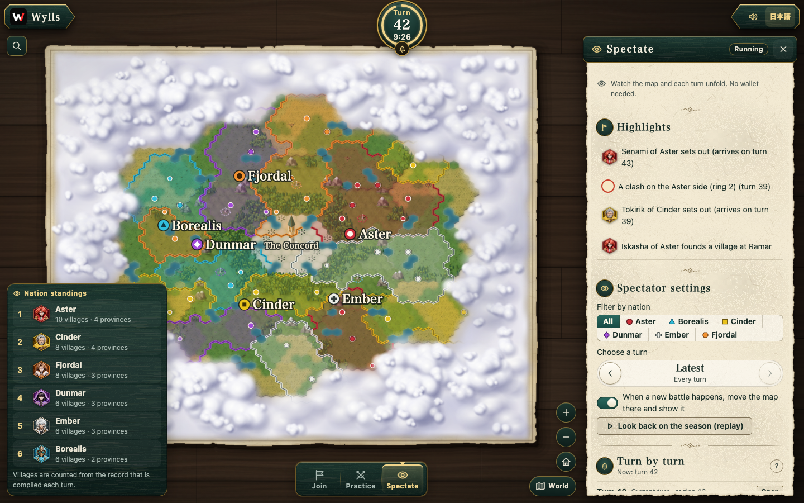

# Wylls

**Play the agent economy.** Wylls is a strategy game where people and AI citizens can fight for one map. The AI citizens use a local Gemma 4 model, goals and records of earlier events; the game checks their choices before they reach the chain.

> **Status 2026-10-26 (`main` at `79c80684`):** submitted to Colosseum's Crypto World's Fair (Gaming) on 2026-10-13; [submission record](SUBMISSION.md#7-submission-record-2026-10-13). The earlier version ran 180 turns on Solana devnet with test USDC and 14 members: 12 operator-run **rule-based** members and two people. Its verifier passed 14 of 14 checks ([record](docs/earlier-prototype/devnet-season-1790355636798-verification.txt); code on `codex/magicblock-playable`). This rebuild completed a seven-game-day season with 1,000 script bots on a local test chain, and it has conquest, a local **test-USDC** entry and prize path, and AI citizens driven by locally hosted Gemma 4. All of the rebuild's runs and recorded demo scenes are local; live USDC on Solana mainnet is planned for the next public season, not launched.
>
> **Merged on 2026-10-24** ([#11](https://github.com/r0ze998/wylls/pull/11), [#8](https://github.com/r0ze998/wylls/pull/8), [#12](https://github.com/r0ze998/wylls/pull/12)): the conquest verifier checks V14–V22, a 14-day conquest season run to its end on a local test chain (2026-10-17/18, on the earlier conquest rules), a behaviour-preserving refactor, and **stage 1 of the redesign, the S1 rules** ([section 2](#s1)). Since then the program on `main` creates and runs **S1 seasons only**; the earlier M1 and conquest (MC) seasons need the program of an earlier commit. The S1 rules are in the program, verifier, keeper and herald, and are tested there; the web client on `main` does not yet show or order the S1 additions, and no S1 season run is recorded in `main`'s documents. The client work for S1 (stage 1f) is on unmerged branches ([section 4](#status)).



*The web client of the rebuild, world view (a screen fixture with test data, captured 2026-10-09; not a live season).*

## 1. What Wylls is

Wylls is a Civilization-style world on a Solana-compatible chain in which six nations (国) share one map. Choose a nation, grow a village (村), train troops and send sealed marches (軍). When a fight resolves, the program decides its outcome and the browser can recompute the report. Capturing a keep can change the map. A verifier can replay a season's transaction log; it is our verifier, not an independent audit. The completed M1 exit season used rule bots, which follow fixed scripts and are not the Gemma-powered AI citizens. Conquest, local test-USDC mechanics and real-model AI runs came later. The season-winner rule (most keeps at the end) and a 14-day season preset are in the code; a 48-game-hour and a 14-day local conquest season with script bots have been run to a final tally (test USDC only). Stage 1 of a redesign, the S1 rules (arms, caravans, raids, towers, palisades, forts, nation votes; [below](#s1)), is now the program's rule set. The wider civilisation, a wider nation score and the live-money season remain plans ([status](#status)).

## 2. How it plays

The game runs in real time, but the results of fights, marches and scouting are not decided at once. Every 10 minutes the world resolves them all together (144 times a day). Each of these steps is a **turn**. Sending an army a minute earlier gives no advantage, because both orders are resolved in the same turn. Economy and building run continuously, with no turn to wait for.

1. **Choose a nation.** This is the only choice needed to join.
2. **Get a village.** In a new season, your first village is placed in your nation's free land as soon as you join. The completed M1 season used an older flow: a site request and a lottery, with the village appearing about 11 to 21 minutes later (a model estimate) and staying provisional for up to about 4 hours.
3. **Grow and train.** Build farms, lumber camps and walls, raise the village's tier, train troops and combine them into armies. Resources accrue in real time.
4. **Scout.** Scouts explore the map; the result arrives at the next turn.
5. **March under a sealed order.** The departure, the size and the arrival turn are public; the destination is hidden by a time-lock on drand (a public randomness beacon that publishes a value at a fixed time) until the arrival turn has ended. A march needs at least two turns to arrive and cannot be recalled.
6. **Read the report.** Anyone can replay a battle report, and the web client re-runs the rules code in the browser to check it.

With conquest enabled, armies can contest and capture keeps; a recorded local demo shows Fjordal's keep changing hands. After a season ends, the prize program names the nation holding the most keeps as the winner (ties go to more territory time, then the prize is shared). One local 14-day season with rule bots reached that tally, with refunds instead of a prize because the winning nation had no paid member; a wider nation score (prosperity, knowledge and so on) is still being designed ([section 4](#status)).

<a id="s1"></a>

**Stage 1 of the redesign (S1 rules; in the program on `main`, not yet in its web client).** The owner's redesign of 2026-10-22/23 ([docs/design/redesign](docs/design/redesign/README.ja.md), Japanese) aims at a world whose citizens build its working parts: supply, transport, defences and the nation's own rules. Its first stage adds these to the rules, the program and the off-chain services. Every figure is provisional (the redesign leaves numbers to a later phase).

- **Arms and workshops.** A workshop turns 2 ore and 1 wood into 1 arm, 4 arms an hour each. Ore depends on the land: hills, mountains and iron within two tiles of a village raise it. Pikemen, crossbowmen and knights cost arms (50, 70 and 40 per 100 troops), and declaring a siege burns 50 arms.
- **Vaults and caravans.** A vault stores goods on a tile. A caravan carries goods between villages and vaults on a route anyone can see, 1.5 times slower than a march. A host of another nation standing on the caravan's tile at a turn raids it and then takes it (the caravan becomes the raider's and heads for the raider's village) or burns its cargo. An escort is a host sent ahead, under a sealed march, to wait on the route; a settlement shelters a caravan standing on its own tile.
- **Watchtowers, palisades and forts.** A tower watches two tiles around it: it reports public events there, and once a march's seal opens it wears down the troops whose route crossed its range (1% a minute walked, at most 30%), as it does caravans. A palisade stops the marches and caravans of nations its owner's nation is at war with, and of villages its own nation expelled. A fort holds up to 2,000 troops and fights on its tile.
- **Nations decide two things.** Each nation's villages vote, one village one vote, on its stance toward each other nation (war, passage or alliance; the stance decides whom towers and palisades stop) and on expelling one of its own villages or taking an expelled one back. A village of the same nation can still raid a caravan, by showing its host stood where the caravan stood; the raid is recorded.

The verifier re-judges these instructions (checks V23–V25 and tamper classes T49–T57), the keeper settles caravans, raids and proposals, and the herald writes their feeds. Stage notes: [1a](docs/frontier/stage1a/S1-1A-NOTES.md), [1b](docs/frontier/stage1b/S1-1B-NOTES.md), [1c](docs/frontier/stage1b/S1-1C-NOTES.md), [1d](docs/frontier/stage1d/S1-1D-NOTES.md), [1e](docs/frontier/stage1e/S1-1E-NOTES.md).

## 3. The AI citizens

**Status: running locally, with formal evaluation unfinished.** The AI-citizen code is in this tree. It uses Gemma 4 through llama.cpp, with no paid model API; the model file and server are external prerequisites. The saved `take-1` run used six real-model AI citizens and six separate script bots on a local test chain, and its `verify-minds` result is PASS. The formal A/B comparison and a completed 18-AI main run remain pending. The earlier devnet season's 12 operator-run rule-based members were not Gemma AI.

- **The code offers, the model chooses, the code checks.** The code builds a short list of legal candidates, the model picks one, and the code validates the pick before the program accepts it. If the model is late, invalid or refused, an autopilot (自動運転) plays: it keeps the economy and routine duties and never starts a march of its own. So a voluntary AI march is chosen by the model or ordered by the nation's council (the Strike Order, below), and most of an AI's actions are the autopilot's. The reason for this design is an early spike: left to itself, the bare model rarely chose to march ([report](docs/frontier/ai-agents/gemma4/REPORT.md)).
- **Memory is cited from public records.** The code writes short event lines from public records (an attack on the AI's army, a camp another nation cleared first); the model never writes them. The page prints the lines the model cited beside its own reason, which is marked not verified. A citation shows that a line was shown and named, not that it caused the choice.
- **An AI citizen's own march.** In the saved `take-1` run, Senasha's turn-65 model choice sent a march toward a camp; the turn-68 clash and camp clear appear in that same decision's result. The page shows the offered options, cited records, model-written reason and local-chain transactions. A citation does not prove the memory caused the choice.
- **The nation council.** The code proposes targets and AI citizens can speak and vote on a sealed **Strike Order** (攻撃命令). The council (評議会) is off-chain; the chain does not enforce its decisions. The selected `take-1` footage shows an AI decision trace, not a human-AI council vote or an adopted Strike Order.
- **Same rules as people, plus safety limits.** AI citizens use the same keys, rate limits and fog of war (players see only part of the map) as people, plus limits such as at most 4 model-chosen marches a day. The model never sees keys; the local test keys derive from a public seed, so this is structure, not secrecy.
- **Display and disclosure.** The council audit page and run roster label AI citizens, script bots and the operator's seat. The planned game presentation does not mark AI citizens. Legal review of AI disclosure has not been done.

The evaluation thresholds are in [the AI contract](docs/frontier/ai-citizens/AI-CITIZENS-CONTRACT.md#102-gates); [earlier run records](docs/frontier/ai-citizens/RUNS.md) remain available. The saved `take-1` evidence is described in [SUBMISSION.md](SUBMISSION.md#recorded-demo-sources-local-test-chains). Its PASS verdict does not complete the formal A/B or 18-AI gate.

<a id="status"></a>

## 4. Status at a glance

| Area | Tag | In one line |
|---|---|---|
| First version (6 nations, 180 turns, officers and votes) | **Ran on devnet** | One full season with a MagicBlock ephemeral rollup, x402 and test USDC: 12 operator-run rule-based members and two people; 14 of 14 verifier checks. Code on `codex/magicblock-playable`; [historical documents](docs/earlier-prototype/INDEX.md) |
| Basic game M1 (the rebuild) | **Running** | Joining, building, training, scouting, sealed marches, clashes and reports, with a replay verifier and a web client (Japanese and English). One 7-game-day season ran on a local test chain with 1,000 script bots |
| AI citizens | **Running locally (earlier rules)** | Integrated code; saved six-AI/six-script-bot `take-1` run with real Gemma 4 and `verify-minds` PASS. Formal A/B and completed 18-AI main run pending. No AI-citizen run under the S1 rules is recorded |
| Conquest (keeps, sieges, occupation) | **Running locally (earlier rules)** | Integrated program and web flow; a human-operated local demo recorded a keep capture in `own1`, season 100, under the earlier conquest (MC) rules. The S1 rules keep conquest and add siege arms |
| 14-day season and season winner | **Implemented; run to the end once, locally (earlier rules)** | One 14-day season (preset `MC_LOCAL_14D`, 2,016 turns, MC program) ran to its end on a local test chain on 2026-10-17/18 (20x, 120 rule bots, three paid test wallets over x402): our verifier passed on its 272,004 transactions, the prize program's Tally and Finalize named the winner (a tie at 10 keeps broken by territory time, provisional rule), and the payout ran in refund mode because the winning nation had no paid member (test units only). The bots raised no siege and filed no outpost in that season, so those paths were exercised in a separate scripted season. `frontier-stack up --conquest` now starts the S1 preset `S1_LOCAL_14D`; no S1 season run to its end is recorded in the documents (PR #12's commit message mentions one end-to-end run in the agent-wallet work). No public season has run. A wider score per nation (prosperity, knowledge) is design only |
| Redesign stage 1, the S1 rules ([section 2](#s1)) | **In the program; not playable in the web client on `main`** | Rules, program, LiteSVM tests, verifier (V23–V25), keeper, herald, relay and script bots on `main` (program version 4, rules version 12). The web client on `main` loads the earlier conquest rules module for an S1 season, which the page then refuses (`RulesetMismatch`; a run on a branch saw the map draw no terrain because of it, commit `93cffa3f`), has no S1 orders or map layers, and the herald writes the S1 feeds without serving them. Branches `design/visual-uplift` (S1 orders on the map, the S1 rules module, the herald routes, a visual overhaul) and `ccr-184d6862-fqutoz` (the branch of PR #9; after it, S1 orders and AI candidates, then stage 2's tickets) carry that work; those later commits are not merged |
| Society (governance, diplomacy, trade, shared Engine, tech, eras) | **Partly in the S1 rules; the rest design only** | S1 adds nation votes on stances and expulsion, and caravans between players. A world that persists across war periods, tickets, markets, the shared Engine, tech and eras are design only on `main` (tickets are built on a branch, above) |
| Money (entry fee and prize path) | **Running locally with test tokens** | The rebuild has a 25 **test-USDC** entry path and prize program on its local chain; the recorded `own1` season shows the prize panel, not a final winner or payout. Live USDC is not launched |

The next public season is **planned** for Solana mainnet with live USDC: 25 USDC entry, 80% of fees to the prize pool and 20% to the operator, subject to legal review. Staking is a later plan, not part of this local build. Each part of the wider design has a status in the [design document](docs/GAME-DESIGN.ja.md) (Japanese).

**Headline evidence for M1** (local test chain, script bots; [exit report](docs/frontier/m1/M1-EXIT-NOTES.md), [run record](docs/frontier/m1/runs/m1-exit/)): one season of 7 game days (1,008 play turns plus 26 closing turns, 8 h 39 min at 20x speed) ran from start to finish with 1,000 script bots, and every gating season criterion passed (one in-process test condition failed on the first commit and was fixed in a later one; see the exit report). The replay verifier passed 144,300 transactions and caught all 30 deliberate tampers.

## 5. Try it

The demos run on a local test chain with a built-in test wallet and valueless test USDC; they need no devnet account or paid service. The real-model run additionally needs a local Gemma 4 GGUF and llama.cpp. **Quick path, the practice battle** (no chain or build; Python 3), from the repository root:

```sh
cd permutation-server/web && python3 -m http.server 8000 --bind 127.0.0.1
# open http://127.0.0.1:8000/frontier/practice.html   (Japanese or English follows your browser)
```

**The current local stack** (an S1 season with conquest, the test-USDC prize path and optional AI citizens) has build prerequisites and guarded commands in [docs/RUNNING.md](docs/RUNNING.md), with what its web page can and cannot do on `main` today. The earlier M1 game and the earlier conquest (MC) seasons no longer start from `main`: the program built from it refuses their seasons, so they need a checkout of an earlier commit ([docs/RUNNING.md §6](docs/RUNNING.md#6-earlier-rule-sets-m1-and-mc)).

**Demo video (submitted):** <https://www.youtube.com/watch?v=M3KXncQcIJg>. **Pitch video:** <https://youtu.be/WMAESO0xbek>. The demo's scenes come from two separate local test-chain runs: the human-operated `own1` conquest run (season 100) and the real-Gemma AI decision in `take-1`. They are not one continuous world.

## 6. Limits and what is not claimed

- **Networks and money.** The first version ran on devnet with test USDC. The rebuild's integrated game and recorded scenes have run on local test chains with test USDC only. Mainnet and live USDC are planned, subject to legal review.
- The first version's devnet season had 12 operator-run rule-based members and 2 people from the project. All 1,000 participants of the rebuild's M1 season were script bots written by the team. There is no registration, demand or traction figure. The longest season run is one local 14-day conquest season with rule bots and three paid test wallets.
- **Seal secrecy was not tested.** The M1 season replayed archived drand values, so the signatures were already known; the results show that marches settle, not that destinations stay secret. The verifier is ours, not an independent audit.
- **AI evaluation remains open.** The saved `take-1` run passed `verify-minds`, but the formal A/B comparison and completed 18-AI main run remain pending. The model's reason is not independently verified; a cited memory line does not prove causation. The council is off-chain, and test-run randomness uses an operator-held test key.
- **The recorded scenes have limits.** `own1` had no AI or bots; `take-1` had no human participant. The edited sequence changes runs, and a 72-turn local clock advance precedes the `own1` keep capture. The browser replay showed six passing checks and a lower `Match` result while an upper `Unverified` badge remained stale. Neither clip shows a final winner, payout or an adopted Strike Order.
- **The S1 rules are new.** Their figures are provisional, their balance band is not met (under the S1 doctrine table, doctrine B sits near −0.7% of the mean index against a ±0.2% gate; [1a notes](docs/frontier/stage1a/S1-1A-NOTES.md)), and the web client, the AI citizens and a full S1 season run are not on `main`. The evidence above for M1, conquest, the prize path and the AI citizens was produced under the earlier rule sets.
- **Wider game still planned:** running a 14-day public season to its end (a local one with rule bots has run once), a nation score wider than keeps and territory time, the redesign's later stages (a world that persists across war periods, tickets, markets), and a shared civilisation. Legal review for live money and AI disclosure has not been done.
- **Changed after submission.** [PR #6](https://github.com/r0ze998/wylls/pull/6) was merged after submission. It stops a sealed AI decision from carrying council speech before its release (a fault found in the `take-2` run) and fixes two viewer reads in the web client. No recorded season has run on the fixed code.
- **Not claimed about the AI:** that it is stronger than the script bots, indistinguishable from people or exactly replayable; that it wants or intends anything; that its memory shows why it chose; that the council is enforced by the chain.
- **Not claimed about the project:** that there is demand, that a game studio was approached, that real money has moved, or that the Civilization-style game is finished.

## 7. Repository map and where to read more

| Path | What it is |
|---|---|
| `permutation-frontier/` | The Solana program, with the LiteSVM tests (`svm-tests/`) |
| `permutation-prize/` | Local test-token entry and prize program; no live-money deployment |
| `permutation-rules/src/frontier/` | The rules code shared by the program, simulator and browser |
| `frontier-abi/`, `frontier-wasm/` | The program's ABI; the rules built to WebAssembly for the browser |
| `frontier-sim/` | The balance simulator |
| `frontier-node/` | Off-chain services: keeper (settles marches and clashes), herald (read-only data server), verifier, script bots, local chain, stack runner |
| `permutation-gateway/` | Relay and x402 test-token joining, JS SDK, AI-citizen service and council page, screen and prize-path tests |
| `permutation-server/web/frontier/` | The web client (map, village, march composer, report, practice page) |
| `scripts/`, `docs/` | Build and run scripts; all documents |

Names are historical: the rename to Wylls did not touch folder, crate or package names, so `permutation-*` and `frontier-*` remain. The first version of Wylls (then named Permutation State) lives on branch `codex/magicblock-playable`; its documents are in [docs/earlier-prototype](docs/earlier-prototype/INDEX.md). Its devnet season is evidence for that version, not for the rebuild's code.

**Where to start:** [Design overview, 10 minutes](docs/DESIGN-OVERVIEW.md) ([日本語](docs/DESIGN-OVERVIEW.ja.md)), then the [design document (Japanese)](docs/GAME-DESIGN.ja.md), the [AI citizens contract v1.3](docs/frontier/ai-citizens/AI-CITIZENS-CONTRACT.md) and the [M1 exit report](docs/frontier/m1/M1-EXIT-NOTES.md). These describe the game up to the earlier conquest rules (2026-10-04 to 10-18). The redesign of 2026-10-22/23 is in [docs/design/redesign](docs/design/redesign/README.ja.md) (Japanese: [the design v1](docs/design/redesign/27-design-v1.ja.md), [the decisions](docs/design/redesign/99-decisions.ja.md), [the stage 1 build plan](docs/design/redesign/30-stage1-build-plan.ja.md)). **Also:** [Run it](docs/RUNNING.md) · [Decisions](docs/frontier/DECISIONS.md) · [Documentation index](docs/frontier/README.md) · [Where each fact lives in the code](docs/frontier/MAINTENANCE.md). **Project records:** [Pitch](PITCH.md) · [Submission record](SUBMISSION.md) · [Demo script](docs/pitch/DEMO_SCRIPT.md)

**License.** The repository root has an MIT `LICENSE` file, which covers the repository as a whole; the Rust crates and the npm package (`permutation-gateway/client`) declare `license = "MIT"` in their manifests, and bundled third-party libraries keep their own licenses.
