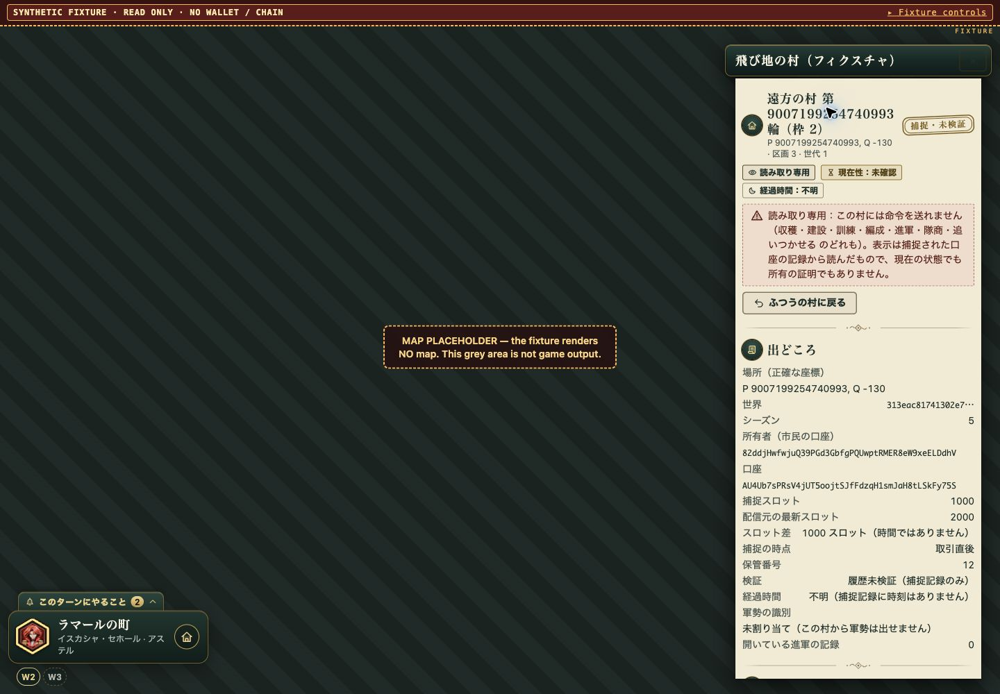
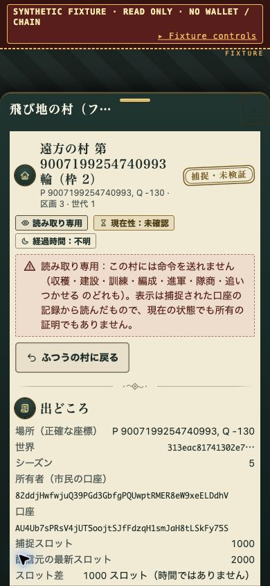
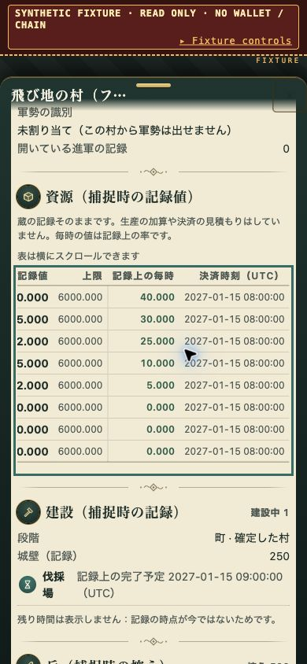
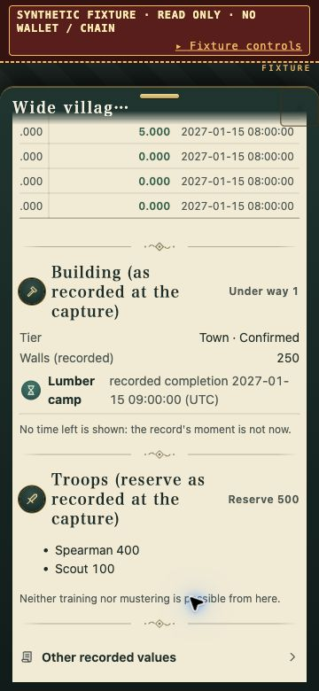
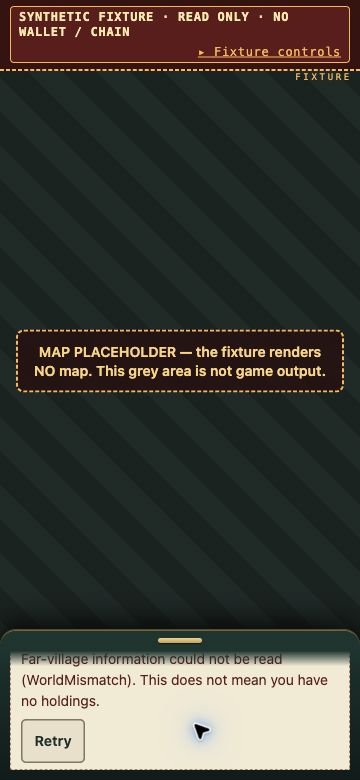

# Wide-holding browser QA, 2026-11-08

Base implementation: `391aa666`. The follow-up was performed in the same isolated
`work/wide-holding-ui-20261108` worktree. The original integration worktree was
not modified. No key pair was generated or derived, nothing was signed or sent
to a chain, and nothing was published, pushed or run in CI.

## What was actually run

Connected Chrome rendered a local synthetic fixture using the production
`fwide`, village/HUD renderers, language dictionaries and CSS. The fixture binds
only to `127.0.0.1:0`, uses fixed public bytes and an existing fixed Season JSON,
and has no wallet/session/relay/RPC. Its own visible badge and map placeholder
identify it as synthetic. All browser interactions used the connected browser
controls; the fixture was not rendered by a screenshot generator.

The existing screens fixture was not run: its startup calls `keyFromSeed`.
Instead, the minimal fixture is preserved under
`permutation-gateway/screens/wide-holding-fixture/` with run instructions.

## Bugs found in the browser and fixed

1. **Desktop W2/W3 and Retry did not accept pointer input.** They sit outside
   `.plate`, so inherited the rail's `pointer-events: none`. Only
   `.rail .wide-pips` and `.rail .wide-inventory-status` now opt into `auto`.
   An actual desktop click opened W2 after the fix; Retry restored the fixture.
2. **The captured resource table escaped a narrow drawer.** At 390px, the
   table was 453.625px wide and extended to x=475.625. The panel body had
   scrollWidth 462px against clientWidth 362px. Only this table is now inside a
   named, focusable horizontal scroll region with a translated visible hint.
   Exact values and all columns remain. No legacy ledger layout was changed.
3. **Recorded timestamps and warning text lacked contrast.** The timestamp
   column now uses paper ink rather than light HUD ink. Wide inventory warnings
   have an opaque paper background, including on the dark rail/resting sheet.

These fixes and their two regression tests were made with Claude Code. Fixture
startup/path/layout mistakes were also corrected before relying on its output:
correct CSS locations and Season kind, ordinary holding drawer geometry rather
than report width, explicit unavailable state, realpath checks for every allowed
file root, and a collapsible inspector bar that does not hide the real content.

## Passed observations

- **1440×1000, Japanese:** W2 selection, repeated selection, normal-village
  return, missing capture, ambiguous capture, invalid-world failure, Retry,
  unavailable source and successfully empty wide inventory. Empty has no warning
  or W selector; unavailable explicitly says ownership is unknown.
- **390×844, Japanese:** phone resting-sheet W2 selection and actual captured
  cards. Panel body clientWidth and scrollWidth both **362px** after the fix.
  The resource region was **346px** wide with **454px** content. A real sideways
  scroll reached scrollLeft **107.5px** of maximum **108px**, revealing the full
  recorded UTC column. The visible hint explains the horizontal scrolling.
- **360×780, English:** panel body clientWidth and scrollWidth both **332px**.
  The resource region was **316px** with **527px** content and scrolled inside
  the card. Recorded construction, reserve 500 (Spearman 400 / Scout 100), and
  no-execution/no-current-state text were visible. The error warning was readable
  and a real scroll in the resting sheet revealed Retry, which restored fixed
  captured data.
- Recorded values remained exact: P=9007199254740993, Q=-130; food 1220.000,
  recorded cap 6000.000 and rate 40.000. No live production or countdown was
  implied. Capture slot 1000, latest folded slot 2000, slot difference 1000
  explicitly not time, currentness unverified and elapsed age unknown.
- Scoped Node regression: **91/91 passed** across the same six key-guarded files,
  including **19** wide UI tests. Changed JS passed `node --check` and the diff
  passed whitespace validation. Rust files did not change in this follow-up.
- All **six** fixed-data scenarios passed a key-guarded parser smoke. The server
  returned 200 only for tested allowed assets, 404 for tested private/source/
  traversal routes, and 405 for a test-only POST. No transaction endpoint exists.
- Independent source review found no remaining confirmed major issue in the
  fixture safety boundary or the narrowly scoped production fixes.

## Limits

The renderer and CSS are real; the world and navigation harness are synthetic.
This does not verify the full app boot, actual controller click wiring, live
herald refresh, wallet/NFT flow, touch dragging, game participation, chain
execution, deployment or wide economic orders. Controller integration remains
covered by separate stubbed Node tests, not by this browser session.

The small phone's peek sheet initially shows the warning but not Retry; scrolling
revealed it. This is a scrollable resting sheet, not proof of the production touch
sheet gestures. The fixture inspector controls are deliberately separate from
normal game UI. The browser console included asynchronous message-channel errors
without a fixture stack; a clean-console result is not claimed.

The pre-existing stale static key-test exclusion-list check remains unchanged;
scoped runtime-guarded passes are not a full suite or CI pass. The local server
was stopped, the temporary viewport override reset, and the inspection tab closed.

## Actual browser captures

All five images below are unmodified Chrome captures of synthetic records, not
mockups or images generated from descriptions. They are preserved locally only.

