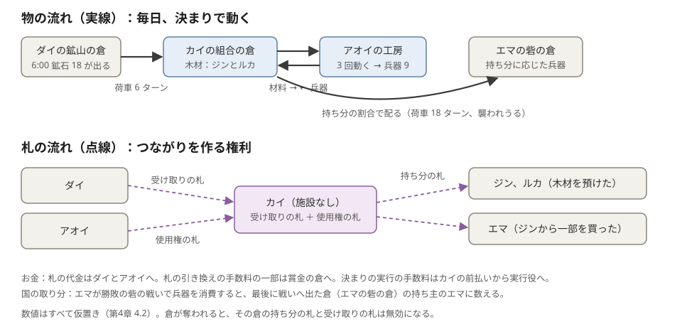

# 第4章 成功例と失敗例

この章で分かること：

- 第3章の部品で、物と札と金がターンごとにどう動くか（成功例 3 つ）
- 材料不足、奪取、襲撃、道の封鎖など、うまくいかない場面で何が起きるか（失敗例 10 個）
- 例を追って見えてきた、まだ決まっていない論点

この章は、[第3章](03-facilities-and-offers.md) の部品の動きを、具体的な例で追います。**数値はすべて【仮】です。** 規則は、断りがなければ【決定済み】のものを使います。決定にない細部は【提案】と書きます。

各例は、1 行の状況から始まり、「この例で分かること」で終わります。

## 4.0 例の前提

| 項目 | 値【仮】 |
|---|---|
| 1 ターン | 10 分【main で確認】 |
| 工房の 1 回分 | 鉱石 6 ＋ 木材 3 → 兵器 3。6 ターンかかる（注） |
| アオイの工房の使用権の札 | 1 日 3 回まで。期限 7 日。値段は木材 30（出しっぱなしの申し出） |
| ダイの鉱山の倉の受け取りの札 | 鉱石を 1 日 18 まで。期限 7 日 |
| 荷車の時間 | 下の一覧 |
| 手数料 | 札の引き換えに少し（一部は賞金の倉へ）。決まりの実行の手数料は前払い（実行役へ） |

注：材料の比は、S1 の実装の「兵器 1 に鉱石 2 と木材 1」にそろえました。速さ（1 時間に 3）は説明のための値です。S1 の工房は 1 時間に 4 で、回数ではなく連続の変換なので、ここでの値とは違います。

荷車の時間：

- ベンの村 → アオイの工房の隣の倉：12 ターン
- ダイの倉 → 工房の隣の倉：6 ターン
- 工房の隣の倉 → 工房：2 ターン（工房 → 隣の倉も 2 ターン）
- 工房の隣の倉 → エマの砦の倉：18 ターン

表の「物の場所（持ち主）」は、物がどこにあり、誰の物かを示します。

## 4.1 成功例 A：工房の使用権を使う（施設の利用条件）

**状況：** ベンが、アオイの工房の使用権の札を買い、自分の材料で兵器を作る。

ベンは、アオイの工房の隣に自分の倉を置きます。材料は、使う側の倉から施設まで荷車で運ぶ規則です。施設の隣に自分の倉を置けば、運ぶ距離が短くなります【決定済み】。

| ターン | 出来事 | 物の場所（持ち主） | 札 |
|---|---|---|---|
| 0 | ベンが、出しっぱなしの申し出に木材 30 を預け、使用権の札を 1 枚受け取る（引き換えの預かり）（注） | 木材 30 → アオイの倉（アオイ） | 使用権の札：ベン |
| 0 | ベンの村から、鉱石 18 と木材 9 を、工房の隣のベンの倉へ送る | 荷車（ベン） | |
| 12 | 荷車がベンの倉に着く | ベンの倉（ベン） | |
| 12〜14 | ベンの倉から工房へ、1 回分の材料を運ぶ | 荷車（ベン） | |
| 14〜20 | 工房が 1 回動く | 工房の中（ベン） | 今日の残り 2 回 |
| 20〜22 | 兵器 3 がベンの倉に入る | ベンの倉（ベン） | |
| 〜 | 同じことをあと 2 回 | 兵器 9：ベンの倉（ベン） | 今日の残り 0 回 |

注：ベンの倉とアオイの市場の倉は、同じ工房の隣にあるとみなします【仮】。

**この例で分かること。**

- 材料も兵器も、最初から最後までベンの物です。アオイは材料を仕入れず、売れ残りの危険もありません。
- アオイは、燃料（建物を動かし続けるための食料など）と維持費を払い続けます。その代わりに、札の代金を受け取ります。
- 札は 7 日間有効です。ベンは毎日 3 回まで使え、余れば札を他人に売れます。

## 4.2 成功例 B：他人の設備を使った前線補給（再利用した仕組み）

**状況：** 施設を持たないカイが、他人の権利をつないで「北の前線補給」を作り、エマの砦に兵器を毎日届ける。

これは段階 3〜4 の世界の例です。

**部品：**

| 部品 | 持ち主 | 中身 |
|---|---|---|
| 受け取りの札 | カイ（ダイから購入） | ダイの鉱山の倉から、鉱石を 1 日 18 まで |
| 使用権の札 | カイ（アオイから購入） | アオイの工房を 1 日 3 回 |
| 組合の倉 | カイ | 工房の隣に置く。持ち分の札を出す |
| 決まり 1 | カイ | 毎日 6 時、受け取りの札で、ダイの倉から鉱石 18 を組合の倉へ送る |
| 決まり 2 | カイ | 組合の倉に鉱石が届いたら、工房を 3 回動かす |
| 決まり 3 | カイ | 組合の倉に兵器が届いたら、持ち分の札の割合で配る |

木材は、平地のジンとルカが組合の倉に預け、持ち分の札を受け取っています。エマは、ジンから持ち分の札を一部買い、自分の分の届け先を砦の倉にしました。

**ある 1 日：**

| 時刻 | 出来事 | 物の場所（持ち主） |
|---|---|---|
| 6:00 | 決まり 1 が判定される（ターンの始め）。ダイの倉から鉱石 18 が出る | 荷車（カイ） |
| 7:00 | 組合の倉に着く | 組合の倉（持ち分の札の持ち主たち） |
| 7:00 | 決まり 2 が判定され、工房へ材料を運ぶ | 荷車 → 工房 |
| 7:20〜10:20 | 工房が 3 回動く | 工房の中 |
| 10:40 | 兵器 9 が組合の倉に入る | 組合の倉 |
| 10:40 | 決まり 3 が判定される。持ち分の割合で、エマの分の兵器 3 が砦の倉へ出る | 荷車（エマの分） |
| 13:40 | エマの砦の倉に着く | エマの砦の倉（エマ） |

**お金と札の流れ：**

- カイは、決まりの実行の手数料を前払いしています。実行役（キーパー）は、そこから払われます。
- 札の引き換えの手数料の一部は、賞金の倉に入ります。
- カイの取り分の作り方は、たとえば次の 2 つです。自分が組合の倉に預けた分の持ち分の札と、仕組みの持ち主として受け取る手数料（段階 4 の持ち主の札）です。

**戦期の取り分（国の賞金）：** エマが、この兵器で勝敗の砦を守る兵を訓練したとします。その兵器は「国の戦いで消費された補給」として数えられます。数える相手は、物が最後に戦いへ出た倉の持ち主です（組合の倉なら、持ち分の札の割合で分ける）【決定済み】。この例では、兵器はエマの砦の倉から戦いに出ます。だから、**数えられるのはエマ** です。

> **気づき（この文書の指摘）：** この数え方では、次の人たちは、自分の倉から直接戦いに物を出さない限り、国の取り分に数えられません。組合の倉を通した補給の作り手（カイ、ジン、ルカ）、鉱石を出したダイ、工房を貸したアオイです。これは、補給の仕組みを作った人が報われるという、取り分の決定の狙い（第7章）と合わない場合があります。五人の見返りは、札の代金やゲームの中の稼ぎです。重みを決めるとき（フェーズ6）の論点として、[第12章](12-open-questions.md) の Q-M3 に挙げます。

**この例で分かること。**

- カイは鉱山も工房も持たずに、「前線に兵器が毎日届く」という働きを作りました。
- エマは鉱山も工房も持たずに、札を買うだけで、砦に兵器が毎日届くようになりました。
- 北の前線補給の持ち分の札も札なので、さらに別の仕組みの部品になれます。

## 4.3 成功例 C：共同利用（軍需組合）

**状況：** 丘の村のアオイと、平地の村のジン・ルカが、国の土地に組合の倉を建てて共同で兵器を作る。

| 出来事 | 物 | 持ち分の札 |
|---|---|---|
| アオイが鉱石 300、ジンとルカが木材 150 ずつを預ける（価値を同じとみなす【仮】） | 組合の倉：鉱石 300、木材 300 | アオイ 50%、ジン 25%、ルカ 25% |
| 組合が兵器を作り、倉に兵器 60 がたまる | 兵器 60 | 同じ |
| 札の割合で配る | アオイに 30、ジンとルカに 15 ずつ | 同じ |
| ルカが持ち分の半分をエマに売る（注） | | アオイ 50%、ジン 25%、ルカ 12.5%、エマ 12.5% |

注：売り買いのたびに、それまでの配分を清算します。

**この例で分かること。**

- 倉を守ることが、札を持つ全員の共通の利害になります。倉が奪われると、持ち分の札は無効になり、中身は奪った側の物になるからです【決定済み】。
- エマは工房も鉱山も持たずに、組合に加わりました。

## 4.4 失敗例

### 失敗 1：材料が足りない

**状況：** ダイの鉱山の倉に、鉱石が 9 しかない日があった。受け取りの札は、カイの分（1 日 18）のほかに、別の人の分（1 日 18）も出ている。

| 項目 | 結果 |
|---|---|
| 受け取り | その日の受け取りを、札の割合で均等に減らす。カイは 4.5、もう一人も 4.5 を受け取る（端数の扱いは【未決定】）【決定済み：割合で減らす】 |
| カイの決まり 2 | 工房の 1 回分（鉱石 6）に届かないので、動かさない。止まって記録に残る【決定済み：失敗は止まって記録】 |
| ダイ | 守れなかったことが記録に残り、仕組みの説明書の実績に出る。運営は止めない【決定済み】 |
| エマ | その日、兵器が届かない。エマの砦の「下回ったら補充」の決まりが、別の倉から引き出し始める |

**この例で分かること：** 元が足りないと、札を持つ全員の受け取りが割合で減ります。下流の決まりは止まって記録に残り、札を出した人（ダイ）の信用の記録になります。

### 失敗 2：満杯

**状況：** 組合の倉の兵器が上限に近いのに、工房から兵器が届いた。

| 項目 | 結果 |
|---|---|
| 届いた荷 | 上限を超えた分は失われる【実装あり：S1】 |
| 防ぎ方 | 「量」の合図を使い、「組合の倉に兵器が 100 を超えたら配る」決まりを置く【提案：画面で満杯の危険を知らせる】 |
| 行き先がなくなっていたとき | 荷は全部失われる【実装あり：S1】 |

**この例で分かること：** 今の実装では、あふれた荷は戻りません。量の合図で先に配る設定や、画面での知らせで防ぐ案があります【提案】。

### 失敗 3：施設や倉が奪われる

**状況：** フジの国が、組合の倉を奪った。

| 項目 | 結果 |
|---|---|
| 倉の中身 | 奪った側の物になる【決定済み】 |
| 持ち分の札と受け取りの札 | 無効になる【決定済み】 |
| カイの決まり | 送り先がなくなったので止まり、記録に残る |
| 札を持っていたアオイ、ジン、ルカ、エマ | 札が無効になり、中身も失う。これが、倉を守ることが共通の利害だった理由 |
| アオイの工房が奪われた場合 | 奪った人が設定を変えられる【提案：建物の共通の決まり】。すでに出ている使用権の札の扱いは決定にない。この文書は、倉の札と同じく無効にする案を出す（[第12章](12-open-questions.md)） |

**この例で分かること：** 倉が奪われると、中身と札がまとめて失われます。施設の使用権の札がどうなるかは、まだ決まっていません。

### 失敗 4：持ち主が止める

**状況：** アオイが、工房の燃料を送らなくなった。

| 項目 | 結果 |
|---|---|
| 工房 | 燃料が切れて止まる。止まった建物は奪いやすくなる【提案：建物の共通の決まり】 |
| カイの使用権の札 | 札はあるが、施設が止まっているので使えない。決まり 2 は止まって記録に残る |
| 札を取り消せるか | 取り消せない。条件の変更は、新しく出す札にだけ効く【決定済み】 |
| 長く止まったら | 廃墟になり、誰でも取り壊して材料の一部を得られる【決定済み】 |
| 払い戻し | 決定にない。この文書は「止まった日は払い戻す」を札の条件に入れられる案を出す（第3章 3.10） |

**この例で分かること：** 持ち主は札を取り消せませんが、施設を止めることはできます。止まった日の払い戻しは、まだ決まっていません。

### 失敗 5：値段が変わる

**状況：** アオイが、使用権の札の値段を木材 30 から 50 に上げた。

| 項目 | 結果 |
|---|---|
| カイが持っている札 | 期限（7 日）まで元の条件のまま【決定済み】 |
| 期限の後 | 新しい札を 50 で買うか、別の工房を探す |
| 仕組みの説明書 | 札の期限が表示される。カイの仕組みを使う人も、来週から値が上がるかもしれないと読める【提案】 |

**この例で分かること：** 値上げは、すでに出た札には効きません。期限が見えるので、下流の人も先の値上がりに備えられます。

### 失敗 6：途中でやめる

**状況：** 取引や仕組みに関わる人が、途中でやめたくなった。

| 場面 | 結果 |
|---|---|
| ベンが引き換えの預かりに木材を預けたが、期限までにアオイの側がそろわなかった | 両方に返る【決定済み】 |
| エマが北の前線補給から抜けたい | 持ち分の札を売るか返す。売り買いのたびに、それまでの配分を清算する【決定済み】 |
| カイが仕組みを止めたい | 決まりを止める。すでに道を進んでいる荷車は、到着まで進む【提案】（今のゲームの進軍も途中で呼び戻せない【main で確認】ので、それにそろえる） |
| カイが前払いを足さない | 前払いが尽きると仕組みは止まり、一覧から外れる。記録は残る【決定済み】 |

**この例で分かること：** どの立場でも抜ける手段があります。ただし、すでに動いている荷車は止まりません（この点は【提案】）。

### 失敗 7：依存先が変わる

**状況：** カイの仕組みが頼っている相手（ダイ、アオイ）の側で、変化が起きた。

| 場面 | 結果 |
|---|---|
| ダイが受け取りの札を出しすぎた | 守れない分は割合で減るだけ。守れなかったことは記録に残り、ダイは信用を失う【決定済み】 |
| ダイの倉が奪われた | ダイの受け取りの札は無効になる【決定済み】。カイの決まり 1 は止まる |
| アオイが別の国に移った | 札は国と関係なく残る【決定済み】。ただし、国どうしが戦争中なら、荷車は敵地を通ることになり、襲われやすい |
| カイが元にした仕組みを、ジンが写して安い仕組みを出した | 写すのは自由。元の作者には支払わない。仕組みの説明書に「元にした仕組み」が出る【決定済み】 |

**この例で分かること：** 他人に頼る仕組みは、相手の信用、倉の安全、国の関係、写した競争相手の影響を受けます。

### 失敗 8：荷車が襲われる

**状況：** エマの分の兵器 3 を積んだ荷車が峠を通るターンに、フジの軍がいた。

| 場面 | 結果 |
|---|---|
| 護衛がいた | カイは、行き先を隠した進軍で、峠のマスに先に軍を送っておいた（決定 J1）。護衛が勝てば、荷は無事で、襲う側に損害が出る【決定済み】 |
| 護衛がいない、または負けた | フジが「奪う」か「焼く」かを選ぶ（注 1）【決定済み】【実装あり：S1】 |
| 奪われた荷車 | 見えるので、エマの国が取り返しに行ける |
| 見張り塔 | フジの国の塔の範囲を通っていれば、荷は道が決まった時点で削られている（最大 30%）（注 2）【実装あり：S1】 |
| 国内の襲撃だった場合 | 「国内の襲撃」として記録に残り、国は投票でその村を追放できる【決定済み】。S1 では、命令（RaidDomestic）と追放の投票がある【実装あり：S1】。画面からは、国内の襲撃をまだ出せない（注 3） |

注 1：**奪う** と、荷車ごとフジのものになり、見える荷車としてフジの村か倉へ進みます（決定 J2）。**焼く** と、荷を全部なくします。

注 2：荷車を削るのは、実装計画と S1 の実装です。決定にあるのは、軍を削ることです。

注 3：同じ国の荷車の襲撃は、段階 1e の手順 3 で入りました（2026-10-24 に main へ）。画面に出すのは、これからの作業です。

**この例で分かること：** 荷車は見えるので、守る側は護衛を先回りさせ、襲う側は奪うか焼くかを選びます。奪われた荷車も見えるので、取り返す次の一手が生まれます。

### 失敗 9：道を封じられる

**状況：** フジの国が、北の前線補給の荷車が通る峠に柵を建てた。フジの国の構えは、エマの国に対して「戦い」。

| 場面 | 結果 |
|---|---|
| 自動の荷車 | 決まりを作ったときに道を固定しているので、柵のマスを通れない。送りは断られて止まり、記録に残る【決定済み：自動の荷車の道は固定】。S1 では、構えが「戦い」の国の柵は、荷車の送りを道の時点で断る【実装あり：S1】 |
| カイとエマの選択 | 下の 5 つ |
| この場面の狙い | 他人への依存が、待つ以外の判断を生むかを見る。補給網（検証する候補）の試作で確かめる場面の一つ（[第11章](11-verification-and-plan.md)） |

カイとエマが選べること：

- 遠回りの道で決まりを作り直す（時間がかかり、別の塔の範囲を通るかもしれない）。
- 別の工房の札を探す。
- 砦の倉の備蓄で耐える。
- 軍を出して柵を奪う・壊す。
- 攻める場所を変える。

**この例で分かること：** 道を封じられると、自動の補給は止まります。そこから先は、迂回・乗り換え・備蓄・反撃・作戦変更のどれを選ぶかの判断になります。

### 失敗 10：戦期が終わる

**状況：** 2 週間の戦期が終わった。

| 項目 | 結果 |
|---|---|
| 勝敗の砦 | どの国のものでもない状態に戻り、守備の兵は家に帰る【決定済み】 |
| 戦争の状態 | 戻る【決定済み】 |
| 倉、札、決まり、仕組み | 続く【決定済み】。北の前線補給は、戦期の境目でも止まらない |
| 次の戦期 | 砦の取り合いは「どの国の補給の仕組みが強いか」の勝負になる |

**この例で分かること：** 戦期で区切られるのは戦争の勝敗だけです。作った仕組みは次の戦期に持ち越され、次の戦いの土台になります。

## 4.5 この章から見えた論点

| 論点 | 内容 | 扱い |
|---|---|---|
| 割合で減らすときの端数 | 4.5 のような端数をどちらに丸めるか | 【未決定】（Q-F4） |
| 施設が奪われたときの使用権の札 | 倉の札は無効と決まっているが、施設の札は決まっていない | 【未決定】（Q-F5） |
| 補給の作り手と上流の人の国の取り分 | 最後に戦いへ出た倉の持ち主に数えるので、組合の作り手や上流の人は取り分を得にくい | 【未決定】（Q-M3） |
| 満杯の倉に届いた荷 | 実装では上限を超えた分が失われる | 画面で知らせる【提案】 |
| 受け取りの札が残っている倉を閉じられるか | S1 の実装では空の倉だけを閉じられる。札は未実装 | 【未決定】（Q-F6） |
| 交換の品の置き場所 | 引き換えの預かりで、離れた倉の品をどう交換するか | 【未決定】（Q-F7） |

## 次に読む

- [第5章 UI/UX と地図](05-ui-map.md)：こうした動きを、地図と画面でどう見せるかの案です。
