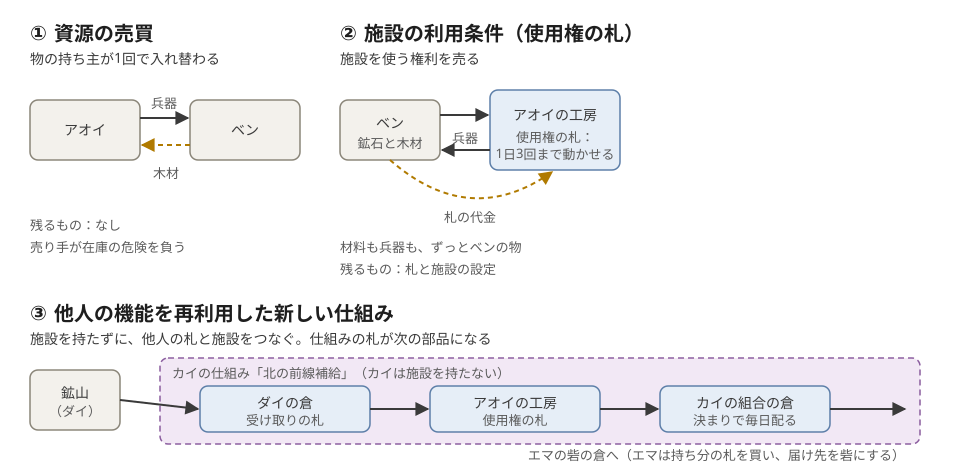

# はじめに：何をするゲームか

> **この文書について。** Wylls のゲーム全体を理解し、設計を判断し、それを基準に開発するための設計書です（2026-10-23 版）。プレイヤー向けの操作説明や宣伝資料ではありません。決まったことには【決定済み】、検証する候補には【検証する候補】、まだ決まっていないことには【未決定】、実装を確かめたことには【実装あり：S1】などの印を付けます。印の意味は [読み方と状態の表し方](00-how-to-read.md) にあります。

## 何をするゲームか

**文明を育て、国どうしで戦いながら、文明の機能そのものも住人が増やしていくゲームです。**【決定済み】

- 畑、鉱山、工房、軍、砦という文明シミュレーションと戦略バトルが土台です。
- 6 つの国のどれかに属し、村を育て、兵を訓練し、砦を取り合います。
- その上で、住人（人間と AI）は、自分の施設を他人に使わせたり、他人の施設や仕組みを組み合わせて新しい仕組みを作ったりします。完成した仕組みは、次の人の部品になります。
- 世界は続き、戦争の勝ち負けだけが 2 週間ごとの「戦期」で区切られます。

## 何が面白いのか

**他の住人への依存が、戦略と駆け引きを生むこと** が、確かめたい面白さです。物流の管理を増やすことが狙いではありません。

> A が工場の生産枠を公開する。B は A の工場と自分の輸送・倉庫を組み合わせ、砦に兵器を届ける補給サービスを公開する。C はそれを自分の軍の運用に組み込む。敵が近道を封じたら、迂回するか、別の工場を探すか、備蓄で耐えるか、護衛を出すか、作戦を変えるか。

誰に頼り、誰を守り、誰の補給を断つかが、戦争の判断になります。この「補給網」は、この面白さを確かめるための **検証する候補の一つ** です。採用は決まっていません。普通の交易より面白いかを小さな試作で確かめてから決めます（[第11章](11-verification-and-plan.md)）。

**最上位の原則。** まず面白いゲームを作ります。Eternum との違いは要りますが、違いを出すためだけに機能を増やしません。判断の順は次のとおりです（再設計の文書に、2026-10-23 のあなたの発言として記録）。

1. 面白い判断と、結果の手応えがあるか。
2. Eternum と違う戦略、対人の関わり、展開を生むか。
3. その判断を直感的に選べ、結果の因果が分かる UI/UX か。
4. 世界観とビジュアル。
5. EVE Frontier の拡張性や、Solana の接続性が、その体験を支えるか。

## 何が決まっていて、何を検討中か

| 状態 | 主なもの |
|---|---|
| 【決定済み】 | 核の一文。文明と戦争の土台を残す。任意のコードを渡さない。資源は無から増えず、許可なく他人の施設に触れない。世界は続き、戦争だけを戦期で区切る。土地と国の形。段階 1〜4 の規則。AI の 4 つの役割と、人と同じ規則。お金の流れの形。賞金を、使われた回数や売った量では数えない |
| 【検証する候補】 | 補給網（他人の生産枠を使う補給サービス）。他人を使う理由（立地、建設時間、設備容量）。Solana の CPI と PDA を使った公開の入口 |
| 【提案】 | 「生きた文明の地図」の画面。hex（六角形のマス）を内部のルールに残すこと。部品の細部、画面の細部、この文書の推奨 |
| 【未決定】 | 数字とトークン。賞金と補給網の会計のつなぎ方。施設が奪われたときの使用権の札と預かり品。「AI ステーキング」の意味。ほか（[第12章](12-open-questions.md)） |
| 【実装あり：S1】 | 段階 1 の一部：兵器と工房、倉と荷車、荷車の襲撃、見張り塔、柵と砦の建物と国の構え。main には未統合の作業ブランチにある |

## 3 つの遊びを分ける

この設計では、似て見える次の 3 つを、別の遊びとして扱います。例の数値は仮です。

| | 何をするか | 例 | 終わったあとに残るもの |
|---|---|---|---|
| **① 資源の売買** | 物と物（または金）を 1 回交換する | アオイが兵器 10 を、木材 40 と引き換えにベンへ渡す | 何も残らない |
| **② 施設の利用条件** | 施設の持ち主が「誰が、いくらで、どう使えるか」を決め、使う権利（使用権の札）を出す。使う人は自分の材料を持ち込み、できた物を受け取る | アオイの工房の使用権の札「1 日 3 回まで動かせる」。ベンが自分の鉱石と木材を運び込み、兵器を受け取る | 札と施設の設定。施設はアオイの物、材料と兵器はベンの物 |
| **③ 他人の機能を再利用した新しい仕組み** | 他人の倉・札・施設を「受け取る → 実行する → 渡す」の形につなぎ、名前を付けて公開する | カイの「前線補給」：鉱山の倉の受け取りの札 ＋ アオイの工房の使用権の札 ＋ 毎日の送りの決まり。兵器が砦の倉に毎日届く。エマは札を買って加わる | 仕組みとその札。仕組みは、さらに別の仕組みの部品になる |

**③ではないもの。** 公開された仕組みの設定を **写して** 自分の施設で動かすのは、テンプレートの共有です。「在庫が減ったら **自動で買う** 」設定は、①を繰り返すだけです。③は、**いま動いている他人の施設の能力** を使って、別の人が使える働きを作ることです（[第3章](03-facilities-and-offers.md)）。

## 破れないルール【決定済み】

- 任意のコードは渡しません。運営が、基本の法則と組み合わせの文法を用意します。
- 資源は無から増えません。許可なく他人の施設に触れられません。
- 運ぶには時間がかかり、運んでいる荷は襲われえます。
- 失敗したら止まって、記録に残ります。

## Wylls の違いをどこに置くか

コードを書かない組み立て、施設どうしの接続、AI、交易、外部のクライアントや拡張には、EVE Frontier や Eternum にも先行例があります。**それだけを「世界初」「独自」とは言いません。** 逆に、他の作品でできるから Wylls に価値がない、とも結論しません。文明戦略としての遊び、UI/UX、世界観、対象のユーザー、チェーンを含めた **体験の全体** で違いを評価します（[第8章](08-comparison-eternum-eve.md)、[第9章](09-chain.md)）。

## この文書の流れ

| 知りたいこと | 章 |
|---|---|
| どんなプレイになるか | [第1章 ゲームの全体像とプレイの流れ](01-overview.md) |
| 世界とルール | [第2章 世界の基本ルール](02-world-rules.md)、[第3章 施設と仕組みの制作・利用](03-facilities-and-offers.md)、[第4章 成功例と失敗例](04-scenarios.md) |
| 画面と地図 | [第5章 UI/UX と地図](05-ui-map.md) |
| AI | [第6章 人間と AI](06-humans-and-ai.md) |
| 経済と世界の継続 | [第7章 経済と世界の継続](07-economy-and-continuity.md) |
| 他の作品との違い | [第8章 Eternum と EVE Frontier との比較](08-comparison-eternum-eve.md) |
| チェーン | [第9章 チェーンの位置づけ](09-chain.md) |
| いま何ができているか | [第10章 現在の実装と、目指す設計の差](10-gap.md) |
| 何をどう確かめ、どの順で作るか | [第11章 試作と検証、開発順序](11-verification-and-plan.md) |
| 決めるべきこと | [第12章 未決定事項と食い違い](12-open-questions.md) |
| 開発の詳細、出典 | [付録](appendix/a-glossary.md) |

5 分で全体をつかむならこのページ、30 分なら第1章・第3章・第4章、判断するときは第11章と第12章を読んでください。
